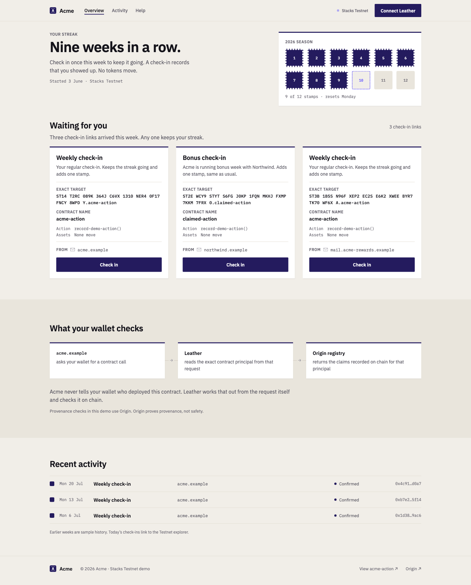

# Origin

[](https://github.com/huth-stacks/origin/actions/workflows/ci.yml)
[](https://explorer.hiro.so/address/ST23YP5Q1WZKDV87KDDB1FQ3W916CQ3MSD09A2VAN.origin-registry-v2?chain=testnet)

Origin is a proof of concept for wallet-owned provenance on Stacks. It lets a wallet answer a narrow question before approving a transaction:

> Who has made an identity claim about this exact principal, and does the wallet recognize that attester?

Origin complements simulation and post-conditions. It does **not** certify that a contract, organization, or transaction is safe.

<p align="center">
  <a href="https://origin-iota-ashy.vercel.app">
    
  </a>
</p>

## Try the demo

- [Applicant](https://origin-iota-ashy.vercel.app) — sends three ordinary SIP-30 contract-call requests.
- [Registry explainer](https://origin-iota-ashy.vercel.app/registry) — explains the trust model using live Testnet records.
- [Evidence explorer](https://origin-evidence.vercel.app/evidence) — shows attester profiles, claims, and lifecycle history.
- [Recording script](docs/demo-recording-speaker-notes.md) — exact narrated walkthrough and technical Q&A.

The companion Leather build demonstrates three outcomes for otherwise identical harmless calls:

| Scenario                                  | Registry state                           | Wallet result                                |
| ----------------------------------------- | ---------------------------------------- | -------------------------------------------- |
| Canonical Acme contract                   | Active claim from a recognized attester  | **Known origin**                             |
| Northwind contract                        | Real claim from an unrecognized attester | **Unrecognized identity claim**              |
| Same-name contract under another deployer | No recognized claim                      | **Unknown origin** + **Potential lookalike** |

## Trust model

```text
Application
  -> sends an ordinary transaction request

Wallet
  -> derives the exact principal from the decoded transaction
  -> queries wallet-configured attesters in the Origin registry
  -> checks attester policy, issuance, expiry, and revocation
  -> renders provenance separately from transaction-risk signals

Origin registry
  -> stores attester-scoped claims and lifecycle events
  -> remains permissionless and does not decide who is trustworthy
```

The requesting application never supplies the organization name, attester hint, trust policy, reference contract, or provenance verdict. A registry or network failure is neutral and can never become **Known origin**.

See [Architecture](docs/architecture.md) for the component boundaries and [Security](SECURITY.md) for the threat model and reporting process.

## Repository contents

| Path                                                                     | Purpose                                                                                  |
| ------------------------------------------------------------------------ | ---------------------------------------------------------------------------------------- |
| [`contracts/`](contracts/README.md)                                      | Clarity v2 registry, legacy v1 reference, domain-proof fixture, and harmless demo target |
| [`demo/`](demo/)                                                         | Applicant, registry explainer, and evidence explorer                                     |
| [`scripts/domain-attester/`](scripts/domain-attester/)                   | Domain proof policy, secure fetcher, store, isolated signer, and IPC boundary            |
| [`scripts/`](scripts/)                                                   | Testnet deployment, issuance, recovery, verification, and operator entry points          |
| [`tests/`](tests/)                                                       | Clarity, TypeScript, security-boundary, recovery, and UI tests                           |
| [`deployments/testnet-fixtures.json`](deployments/testnet-fixtures.json) | Public Testnet deployment and claim receipts                                             |
| [`docs/`](docs/README.md)                                                | Current design, security, demo, review, and historical documentation                     |

The Leather integration remains a separate patch against `leather-io/mono`; Leather source is not vendored here. [`leather-review-manifest.md`](leather-review-manifest.md) records that review boundary.

## Quick start

### Prerequisites

- Node.js 22
- pnpm 10.33.0 via Corepack
- [Clarinet 3.23.1](https://docs.stacks.co/clarinet/overview)

```sh
git clone https://github.com/huth-stacks/origin.git
cd origin
corepack enable
pnpm install --frozen-lockfile
pnpm verify
```

`pnpm verify` runs formatting checks, secret hygiene, Clarity analysis, TypeScript type checking, 294 tests, and a production demo build.

Start all three local web surfaces with:

```sh
pnpm demo:dev
```

Then open:

- <http://127.0.0.1:4173/>
- <http://127.0.0.1:4173/registry>
- <http://127.0.0.1:4173/evidence>

## Live Testnet state

The current v2 registry and six harmless fixture contracts are deployed on Stacks Testnet. The secret-free verifier compares live contract sources and claim state with this checkout:

```sh
pnpm testnet:verify
```

Canonical anchors:

- Registry: [`ST23YP5Q1WZKDV87KDDB1FQ3W916CQ3MSD09A2VAN.origin-registry-v2`](https://explorer.hiro.so/address/ST23YP5Q1WZKDV87KDDB1FQ3W916CQ3MSD09A2VAN.origin-registry-v2?chain=testnet)
- Registry deployment: [`0x8a2c71…46de3`](https://explorer.hiro.so/txid/0x8a2c71ba986643dab5a4e992e0edecf5b5c6c4752fdd1cbd9f42f572a8646de3?chain=testnet)
- Known Acme claim: [`0xeeaa16…79cb6`](https://explorer.hiro.so/txid/0xeeaa16f586079c7096433fa77d1496b6816cf294d789c2b84420a81d38279cb6?chain=testnet)

The complete immutable record is in [`deployments/testnet-fixtures.json`](deployments/testnet-fixtures.json).

## Safety around network-writing commands

Commands without a suffix are read-only dry runs. `:prepare` commands sign and journal exact bytes locally without broadcasting. Only explicit `:broadcast` commands write to Testnet.

Do not run preparation or broadcast commands with valuable keys. The included workflows are for disposable Testnet accounts, and all credentials must remain in ignored `*.local.*` files.

## Project status

Origin is a reviewed, live-Testnet proof of concept—not a production identity or verification service. Current status, verification evidence, and known limits are recorded in [`PROJECT-STATUS.md`](PROJECT-STATUS.md).

Contributions are welcome; read [`CONTRIBUTING.md`](CONTRIBUTING.md) before opening a pull request. Security-sensitive findings should follow [`SECURITY.md`](SECURITY.md), not a public issue.
